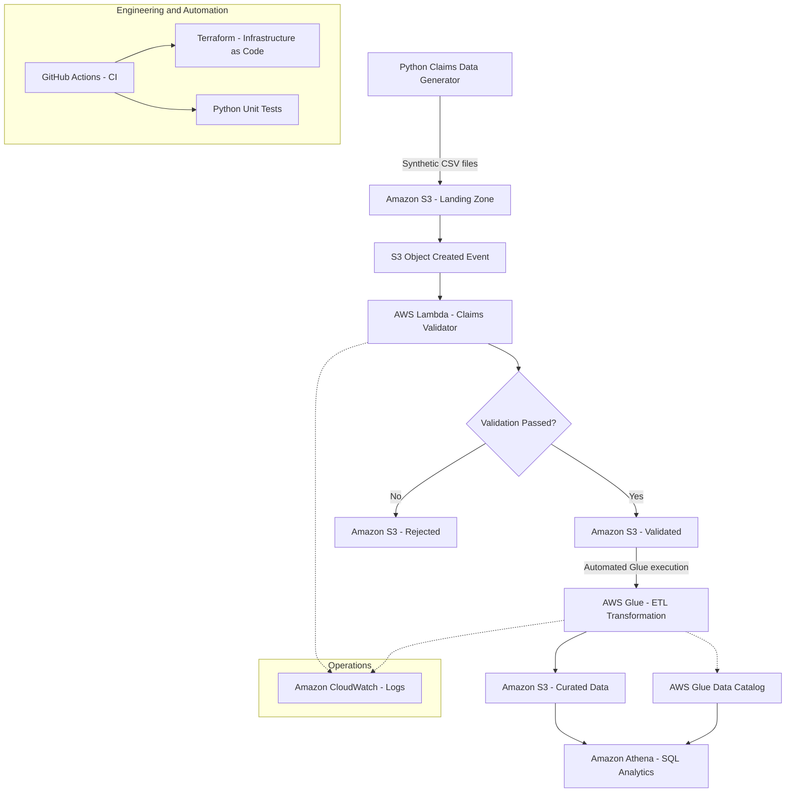

# AWS Claims Data Platform — Architecture

## Overview

An AWS-based data engineering platform that ingests synthetic healthcare claims, validates data quality, transforms accepted records, and makes curated data available for SQL analytics.

The platform was deployed and tested in AWS. Resources were subsequently destroyed to control costs.

## Architecture Diagram

## Key Components

| Component | Responsibility |
|---|---|
| Python | Generate synthetic claims data |
| Amazon S3 | Store landing, validated, rejected, and curated data |
| AWS Lambda | Validate required columns, dates, and claim amounts |
| AWS Glue | Transform accepted claims into analytics-ready data |
| Glue Data Catalog | Maintain table metadata for analytics |
| Amazon Athena | Query curated claims using SQL |
| Terraform | Define and manage AWS infrastructure |
| GitHub Actions | Run Python and Terraform validation checks |
| CloudWatch | Capture Lambda and Glue execution logs |

## Data Processing Flow

1. Python generates synthetic healthcare claims CSV files.
2. Files are uploaded to the S3 landing location.
3. An S3 event invokes the Lambda validator.
4. Valid files are routed to the validated location.
5. Invalid files are routed to the rejected location.
6. AWS Glue processes validated claims.
7. Transformed data is written to the curated location.
8. Athena queries the curated dataset using Glue catalog metadata.

## Validation Rules

The Lambda validator checks:

- Required CSV columns
- Non-empty required fields
- Service dates in YYYY-MM-DD format
- Positive numeric claim amounts
- Files containing at least one claim

## CI/CD and Quality Assurance

GitHub Actions automatically performs:

- Python syntax validation
- Seven claims validator unit tests
- Terraform formatting checks
- Terraform configuration validation

The CI workflow does not deploy AWS resources.

## Implementation Notes

- AWS infrastructure was deployed and tested, then destroyed to minimize costs.
- Athena catalog configuration was performed manually.
- Terraform state is local and excluded from Git.
- Redshift is a future enhancement, not part of the implemented pipeline.
- Monitoring improvements, failure alerts, and end-to-end automated tests remain future work.
